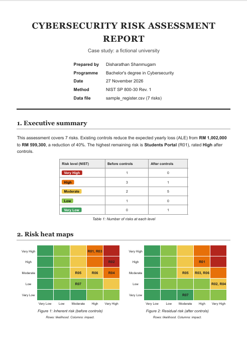

# Cybersecurity Risk Assessment Calculator

A Python tool that reads a cybersecurity **risk register** (CSV file) and creates a
**risk assessment report** with heat maps, before/after-control risk scores and the
estimated yearly loss for each risk.
📄 Full project write-up: [Project_Report.pdf](Project_Report.pdf)

I built this as a student project to practise risk assessment, the first step in
deciding what a security team should protect first.



## What it does

- Rates likelihood and impact on the **NIST SP 800-30** scale: Very Low, Low, Moderate, High, Very High
- Finds each risk level from **NIST SP 800-30 Table I-2** (likelihood × impact)
- Rates impact using the **CIA triad** (Confidentiality, Integrity, Availability)
- Shows risk **before and after** existing security controls
- Estimates the **yearly loss in RM**: `SLE = Asset value x Exposure factor`, `ALE = SLE x ARO`
- Gives a **recommended action** for each risk level
- Creates an **HTML report** (heat maps + ranked table) and a **CSV** of the results
- Uses only standard Python, so there's nothing to install

## How to run

```bash
python assess.py                          # assess the sample register
start reports\risk_report.html            # open the report (Windows)
python -m unittest discover -s tests -v   # run the tests
```

## Risk levels (NIST SP 800-30 Rev. 1, Table I-2)

| Likelihood ↓ / Impact → | Very Low | Low | Moderate | High | Very High |
|---|---|---|---|---|---|
| **Very High** | Very Low | Low | Moderate | High | Very High |
| **High** | Very Low | Low | Moderate | High | Very High |
| **Moderate** | Very Low | Low | Moderate | Moderate | High |
| **Low** | Very Low | Low | Low | Low | Moderate |
| **Very Low** | Very Low | Very Low | Very Low | Low | Low |

What each level means ([NIST SP 800-30 Rev. 1](https://csrc.nist.gov/pubs/sp/800/30/r1/final), Table I-3) and the suggested response, using the five risk response types in [NIST SP 800-39](https://csrc.nist.gov/glossary/term/risk_response) (accept, avoid, mitigate, share, transfer):

| Level | Meaning (Table I-3) | Suggested response (SP 800-39) |
|---|---|---|
| Very High | Multiple severe or catastrophic adverse effects | Mitigate as a priority, or avoid |
| High | Severe or catastrophic adverse effect | Mitigate |
| Moderate | Serious adverse effect | Mitigate, or share/transfer |
| Low | Limited adverse effect | Accept if within risk tolerance, and monitor |
| Very Low | Negligible adverse effect | Accept and monitor |

The final response depends on the organisation's risk tolerance, as NIST SP 800-39 explains.

## Risk register columns

| Column | Meaning |
|---|---|
| `likelihood` | How likely it is to happen: 1 Very Low, 2 Low, 3 Moderate, 4 High, 5 Very High |
| `confidentiality`, `integrity`, `availability` | Damage to each, same 1-5 NIST scale |
| `control_effectiveness` | How much the existing control helps, 0-100 % |
| `asset_value` | Value of the asset in RM |
| `exposure_factor` | % of the asset value lost in one incident |
| `aro` | Incidents expected per year (0.5 = once every 2 years) |

The sample data is a **fictional university**. All values are my own estimates.

## Project files

```
risk_engine.py          all the formulas
assess.py               reads the CSV, writes the reports
data/                   sample risk register
reports/                generated reports
tests/                  unit tests
```

## What I learned

- How NIST SP 800-30 combines likelihood and impact into a risk level
- How the CIA triad helps rate impact
- The difference between risk before controls (inherent) and after controls (residual)
- How to put a money value on a risk with SLE and ALE
- Writing Python that reads CSV files, generates HTML and is checked by unit tests

## Ideas to improve

- [ ] Map each threat to a MITRE ATT&CK technique
- [ ] Add a simple web form to enter risks
- [ ] Export the report as PDF

## References

NIST SP 800-30 Rev. 1 *Guide for Conducting Risk Assessments*; NIST SP 800-39 *Managing Information Security Risk*; ISO/IEC 27005.
